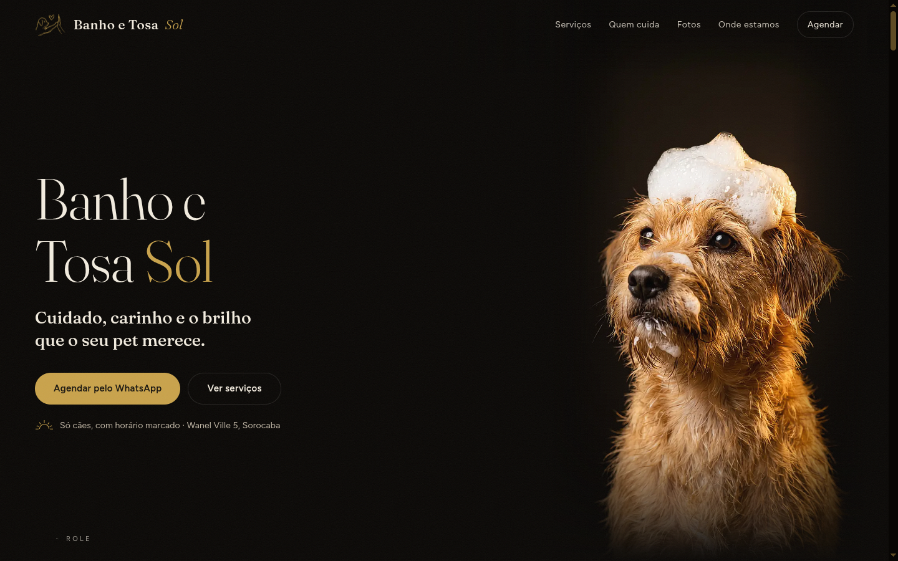
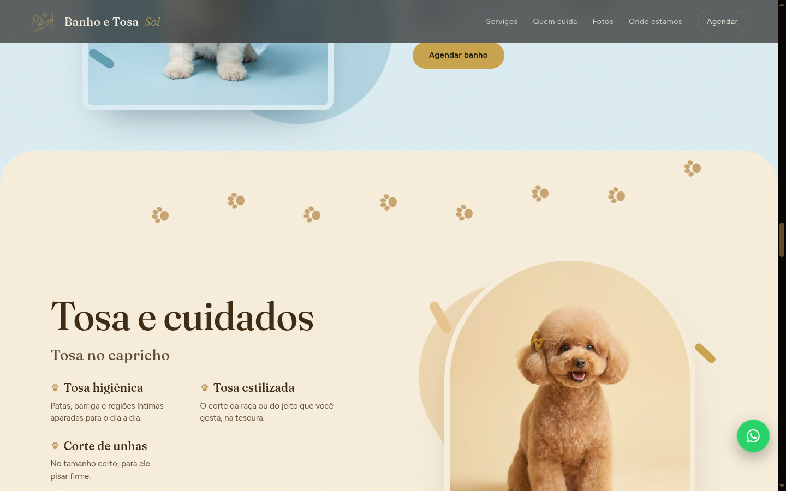
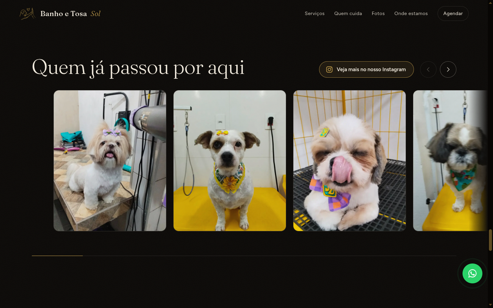
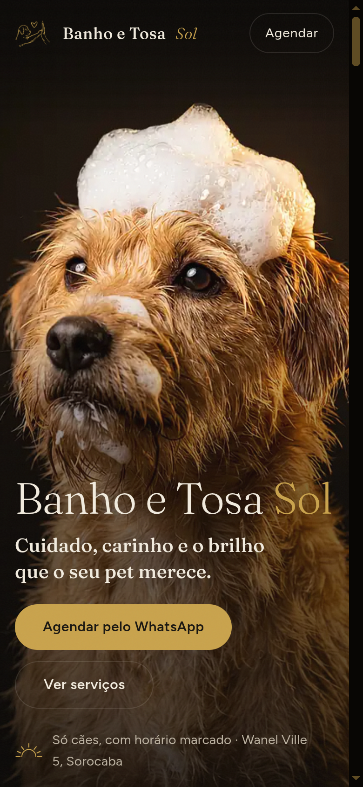

# Banho e Tosa Sol — site cinematográfico para pet shop

Site de uma página para o **Banho e Tosa Sol**, um banho e tosa real em Sorocaba/SP. A rolagem funciona como um filme: o cachorro do vídeo de abertura acompanha o visitante enquanto os serviços aparecem.

**▶ Ver ao vivo:** https://banhoetosa.eduardotorres-dev.com.br

| Abertura | Serviços |
|---|---|
|  |  |
| **Galeria** | **No celular** |
|  |  |

## Destaques

- **Rolagem cinematográfica**: um vídeo gerado por IA é fatiado em 128 quadros (WebP) e desenhado num `<canvas>` conforme a rolagem, com versões separadas para computador e celular.
- **Identidade da marca**: preto e dourado tirados dos cartões do negócio, tipografia Fraunces + Figtree e o logo em traço aproveitado do cartão de visita.
- **Feito para converter**: botão flutuante de WhatsApp com mensagem pronta, formulário de contato que chega por e-mail e mapa do endereço.
- **Conteúdo real**: fotos do salão, a profissional que cuida dos pets e os serviços (banho, tosa, hidratação, unhas, creche e táxi dog).
- **Leve e acessível**: HTML, CSS e JavaScript puro, sem framework. Imagens em WebP com cache, e o site respeita quem prefere menos movimento.

## Como foi feito

1. Briefing com a dona do negócio: serviços, público, fotos e materiais da marca.
2. Vídeo de abertura e ilustrações gerados com IA (Veo e Gemini), seguindo a identidade visual.
3. Vídeo fatiado em quadros com `ffmpeg` para a animação controlada pela rolagem.
4. Publicado na Hostinger em banhoetosa.eduardotorres-dev.com.br (o `netlify.toml` ficou do deploy antigo na Netlify).

## Estrutura

```
site/
├── index.html      # página única
├── estilo.css
├── app.js          # rolagem com canvas, galeria, formulário
├── config.js       # WhatsApp, e-mail e quadros: o que muda de cliente para cliente
└── assets/         # quadros do vídeo, imagens e logo
```

Para rodar no seu computador: `npx serve site`

---

Feito por **Eduardo Torres**: crio sites para negócios locais. Quer um assim? [Me chame no LinkedIn](https://www.linkedin.com/in/eduardo-torres-769aa963/).
